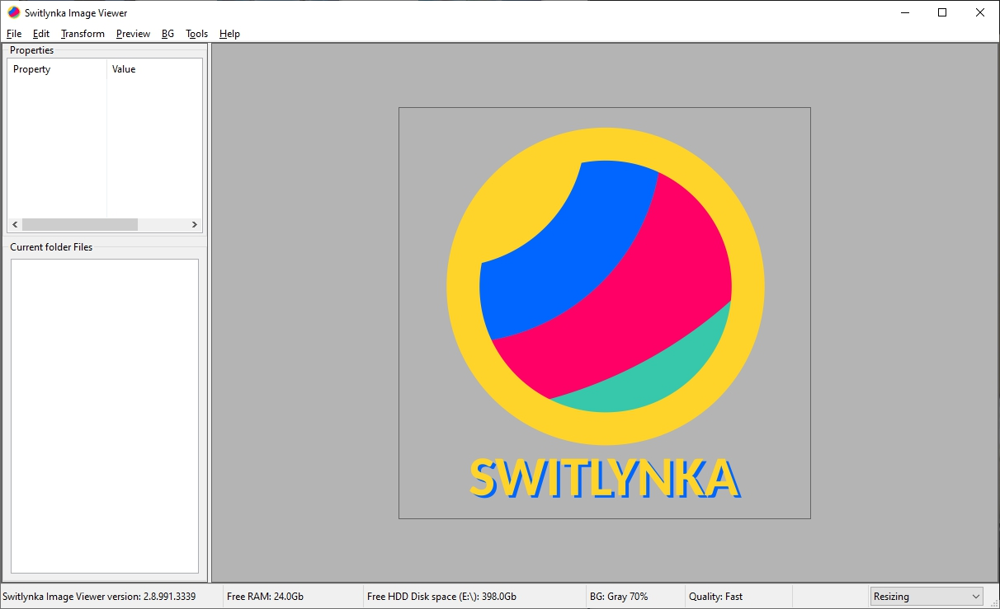
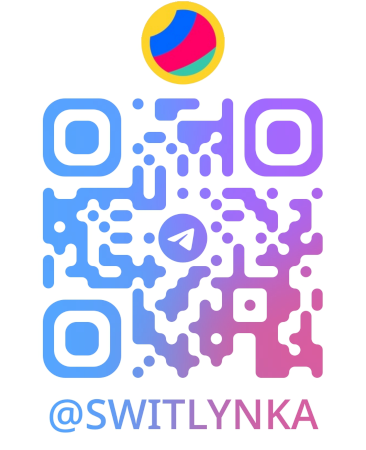

# 📷 Switlynka (Світлинка)

**Switlynka (Світлинка)** — це надшвидкий, багатофункціональний і легкий переглядач графічних файлів та відеоматеріалів із відкритим кодом. Програма поєднує можливості сучасного переглядача фото, рушія для перегляду надвеликих карт (гігапіксельних растрових масивів), інструментів інтерактивного кадрування у стилі Krita, відеопрогравача з покадровим захопленням через **FFmpeg**, розширеного конвертування за допомогою **ImageMagick** та системних утиліт для тонкого налаштування ОС.

---

## 🚀 Що нового в останній версії

- ✋ **Інструмент «Рука» (Hand Tool, Spacebar Pan)**: миттєве переміщення по зображенню затисканням клавіші **Пробіл (Spacebar)** та лівої кнопки миші у стилі графічних редакторів Krita та Photoshop.
- 🎯 **Курсорне масштабування за зразком GIMP (Zoom Focus: Mouse Pointer)**: збільшення та зменшення через `Ctrl + коліщатко миші` строго навколо точки під курсором без найменшого зсуву вбік.
- 🗺️ **Підтримка гігапіксельних зображень та карт (Display-Space Tile Grid)**: перегляд надвеликих файлів (наприклад, супутникових мап $16384 \times 16384$ px, 1 ГБ RAM) у реальному масштабі 1:1 («100%») та наближенням до 3200% без змазування, шлейфів чи вичерпання дескрипторів Windows GDI.
- ✂️ **Дзеркальне симетричне кадрування (Krita Style Ctrl-Crop)**: підтримка симетричного масштабування рамки кадрування від центру при затиснутій клавіші `Ctrl` (та комбінації `Shift + Ctrl` для пропорційного квадрата).
- 🎬 **Повноцінний відеоплеєр-селектор кадрів (Video Frame Extraction)**: підтримка Drag-and-Drop відео (MP4, MKV, MOV, AVI, WMV, MXF, TS, WebM), видобування кадрів за мілісекунди, калібрування діапазону Rec.709 TV Range (16-235) $\to$ Full PC sRGB (0-255), збереження альфа-каналу відео та покадровий перехід за реальним FPS.
- ⚡ **Оптимізоване відтворення анімацій**: кешування кадрів GIF, APNG та WebP із повною підтримкою високочастотного таймінгу 50–60 FPS без ривків та навантаження процесора.
- 📐 **Динамічний векторний рушій для EPS та AI (Adobe Illustrator)**: повноцінна підтримка Encapsulated PostScript (.eps) та Adobe Illustrator (.ai). При збільшенні масштабу користувачем (Ctrl + Wheel або Custom size) програма автоматично динамічно перераховує необхідний DPI та рендерить векторне зображення з максимальною кришталевою чіткістю без пікселізації (аналогічно до SVG). Вбудована підтримка миттєвого зчитування TIFF-прев'ю з файлів DOS EPS та багаторівнева інтеграція з Ghostscript, Poppler () та ImageMagick.
- 🔍 **Повна підтримка прозорості (Alpha Channel)**: ідеальне відображення векторних SVG, iOS HEIC/HEIF, AVIF, WebP, Photoshop PSD/PSB, DDS, TIFF та XCF без білого тла.
- 💾 **Розумне збереження файлів (Smart File Naming)**: автоматичне підтягування імені, папки та формату оригінального файлу при збереженні, пункт меню швидкого перезапису («File overwrite»).

---

## 🌟 Ключові можливості

### 1. Перегляд та навігація зображеннями
- **Широкий спектр форматів**: стандартні PNG, JPG, JPEG, BMP, GIF, WEBP, TIFF, ICO, TGA, SVG, PNM, XPM, Base64; розширені професійні та RAW формати через ImageMagick.
- **Два режими швидкості перегляду каталогу**:
  - *Normal Mode*: побудова високоякісних мініатюр 150×150 px у фоновому потоці (`std::thread`) без блокування інтерфейсу.
  - *Fast Speed Mode (`F9`)*: миттєве завантаження тисяч файлів у компактний список без витрат часу на генерацію прев'ю.
- **Режими перегляду**:
  - **Resizing (FitToWindow)**: повна адаптація розміру кадру під геометрію вікна.
  - **100% (Original100)**: виведення у справжній вихідній роздільній здатності 1:1 із центруванням та активними скролбарами.
  - **Custom size**: довільне плавне масштабування від 5% (0.05x) до 3200% (32x) коліщатком миші з `Ctrl` або гарячими клавішами.
- **Плаваючий оверлей навігації**: круглі напівпрозорі стрілки швидкого переходу до попереднього/наступного фото в теці.

### 2. Панорамування Hand Tool та плитковий рушій
- **Hand Tool (Пробіл + ЛКМ)**: якщо зображення перевищує розміри вікна у режимах 100% або Custom size, утримання клавіші Пробіл перетворює курсор на руку, дозволяючи перетягувати полотно з високою плавністю 60 FPS.
- **Дисплейна плиткова сітка (Fixed Tile Grid, 512×512 px)**: для надвеликих зображень (понад 48 Мп) растр розбивається на екранні плитки розміром 1 МБ кожна. Це захищає від переповнення пам'яті GDI DIB section та гарантує стабільну роботу на моніторах будь-якої роздільної здатності.

### 3. Інтерактивне та геометричне кадрування
- **Krita-Style Crop Area (`Alt+A` або подвійний клік ЛКМ)**:
  - 8 інтерактивних маркерів зміни розміру зі зміною курсора миші.
  - Напівпрозоре 50% затемнення неробочої області.
  - Утримання `Shift` — фіксація вихідного або квадратного співвідношення сторін.
  - Утримання `Ctrl` — дзеркальне симетричне трансформування від центральної точки.
  - Підтвердження обрізки клавішею `Enter`, скасування — `Esc`.
- **Маски виділення**:
  - `F6` (Rectangle Mask) — вільне або квадратне виділення прямокутником.
  - `F7` (Circle Mask) — еліптична або кругла маска з субпіксельним згладжуванням країв та збереженням прозорого фону.
- **Пропорційне кадрування (`Alt+C`)**: шаблони 16:9, 9:16, 1:1, вибір режимів змішування альфа-каналу (Multiply, Screen, ReplaceOriginal).

### 4. Відеопрогравач та покадрове видобування (FFmpeg)
- Відкриття відео через діалог або прямий **Drag-and-Drop** контейнерів MP4, MOV, MKV, AVI, WMV, MXF, MPG, TS, WebM.
- Зондування метаданих: точний хронометраж `ГГ:ХХ:СС / ГГ:ХХ:СС`, частота кадрів FPS, загальна кількість кадрів та лічильник `Кадр: [X] / [Y]`.
- Покадровий крок (`<< 1 кадр`, `1 кадр >>`) з математичною точністю на основі реального FPS відеопотоку.
- Апаратне калібрування телевізійних форматів MXF Rec.709 Limited Range (16-235) $\to$ Full PC Range (0-255).
- Збереження прозорого альфа-каналу для кодеків Apple ProRes 4444, PNG-video, WebM VP8/VP9 alpha.

### 5. Обробка та трансформація зображень
- **Яскравість та контрастність (`Ctrl+B`)**: швидке інтерактивне регулювання повзунками.
- **Відтінки сірого (`Ctrl+G`)**: знебарвлення зі збереженням альфа-прозорості.
- **Розмиття (`Ctrl+R`)**: радіальне, горизонтальне або вертикальне згладжування.
- **Трансформація**: поворот на 90° за годинниковою (`Alt+.`), проти годинникової (`Alt+,`), поворот на 180°, горизонтальне (`Alt+[`), вертикальне (`Alt+]`) віддзеркалення.
- **Історія скасування (`Ctrl+Z`)**: до 15 кроків відкату змін.

### 6. Системні утиліти та тонке налаштування
- **System Information (`Alt+Shift+S`)**: докладний звіт про операційну систему, збірку Windows UBR, процесор, температуру ACPI, оперативну пам'ять, диски та обсяг відеопам'яті GPU VRAM.
- **System PATH Editor (`F5`)**: редагування системної змінної оточення `PATH`.
- **Autorun App Manager (`Alt+Shift+A`)**: керування автозавантаженням (реєстр HKCU/HKLM, папки Startup, Wow6432Node, UAC-ескалація).
- **Зміна яскравості монітора (`Alt+Shift+L`)**: пряме апаратне керування яскравістю через DDC/CI та WMI.
- **Режим «Поверх інших вікон» (`Alt+F9`)**: фіксація вікна програми поверх інших додатків.
- **Кольори фону (`Ctrl+0` ... `Ctrl+7`)**: швидкий вибір підкладки (сірий, чорний, білий, градації яскравості).

---

## ⌨️ Таблиця гарячих клавіш

| Комбінація клавіш | Дія |
| :--- | :--- |
| **Spacebar (Пробіл) + ЛКМ Drag** | Переміщення по зображенню інструментом «Рука» (Hand tool) |
| **Ctrl + Коліщатко миші** | Плавне масштабування полотна з фіксацією точки під курсором (GIMP style) |
| **Подвійний клік ЛКМ / Alt + A** | Активація інтерактивної рамки кадрування (Crop Area) |
| **Shift (утримувати)** | Пропорційне кадрування (квадрат або вихідне співвідношення) |
| **Ctrl (утримувати)** | Дзеркальне симетричне кадрування сторін від центру |
| **Enter / Esc** | Застосувати кадрування / Скасувати режим кадрування |
| **Ctrl + O** | Відкрити файл зображення або відео |
| **Ctrl + S** | Зберегти поточне зображення (з оригінальним іменем за замовчуванням) |
| **Ctrl + Shift + S** | Зберегти зображення у поточному екранному розмірі |
| **Ctrl + Z** | Скасувати останню дію (Undo) |
| **Ctrl + C / Ctrl + V** | Копіювати / Вставити зображення через буфер обміну |
| **F6 / F7** | Малювання прямокутної / круглої маски кадрування |
| **F11 / Esc** | Повноекранний режим / Вихід із повноекранного режиму |
| **Стрілки Вліво / Вправо** | Попереднє / наступне зображення у папці |
| **F3** | Довідка гарячих клавіш програми |
| **F5** | Редактор системної змінної `PATH` |
| **F8** | Відправити звіт про роботу або помилку |
| **F9 / Alt + F9** | Режим швидкого читання папок / Закріпити вікно поверх інших |
| **Alt + Shift + S** | Звіт системної інформації (Hardware & OS Info) |
| **Alt + Shift + A** | Менеджер автозавантаження Windows |
| **Alt + Shift + L** | Апаратна яскравість монітора (DDC/CI) |

---

## 📁 Структура меню програми

### Меню «File»
- **New Background... (`Ctrl+N`)** — створення однотонного полотна за шаблонами (FHD, 4K, A4 тощо).
- **Open File... (`Ctrl+O`)** — відкриття зображень або відео через стандартний селектор.
- **Save File As... (`Ctrl+S`)** — збереження поточного зображення у вихідній максимальній якості.
- **Save File As Resizing... (`Ctrl+Shift+S`)** — експорт зображення у поточному екранному масштабі.
- **File overwrite** — прапорець дозволу прямого перезапису існуючого файлу.
- **Save Property (`Ctrl+Shift+P`)** — збереження поточних перемикачів меню в `property.json`.
- **Quit (`Ctrl+Q`)** — вихід із програми.

### Меню «Edit»
- **Undo (`Ctrl+Z`)** — скасування останньої операції (глибина до 15 кроків).
- **Copy (`Ctrl+C`) / Paste (`Ctrl+V`)** — обмін графічними даними з буфером обміну.
- **Brightness / Contrast (`Ctrl+B`)** — налаштування освітлення та контрасту.
- **Grayscale (`Ctrl+G`) / Blur (`Ctrl+R`)** — знебарвлення та фільтри розмиття.
- **Crop... (`Alt+C`)** — пропорційне кадрування за попередньо заданими пресетами.
- **Draw Rectangle Mask (`F6`) / Draw Circle Mask (`F7`)** — маски обрізки.
- **Crop Image Area (`Alt+A`)** — рамка інтерактивного кадрування Krita Style.

### Меню «Transform»
- **Rotate 90 (`Alt+.`) / Rotate -90 (`Alt+,`) / Rotate 180** — геометричні повороти.
- **Flip Horizontal (`Alt+[`) / Flip Vertical (`Alt+]`)** — дзеркальні розвороти.

### Меню «Preview» та «BG»
- **Quality** — алгоритми інтерполяції (Default, None, Fast, Good, Best).
- **Show Property List (`Alt+9`)** — бічна таблиця властивостей та EXIF-метаданих.
- **Show Folder List (`Alt+0`)** — бічна панель мініатюр поточної теки.
- **Show Full Screen (`F11`)** — повноекранний огляд.
- **BG Color (`Ctrl+0` ... `Ctrl+7`)** — палітра фонових кольорів підкладки.

### Меню «Tools»
- **Open File (ImageMagick) (`Alt+Shift+O`)** — імпорт складних/рідкісних растрових та векторних форматів.
- **Folder Rescale (ImageMagick) (`Alt+Shift+P`)** — пакетна конвертація, генерація GIF та монтажних аркушів (Sprite Sheets).
- **Images Folder As Video (FFMpeg) (`Alt+I`)** — збирання відеоряду з фотографій теки.
- **Video As Images (FFMpeg) (`Alt+Shift+I`)** — пакетний покадровий експорт відео у зображення.

---

## 🛠️ Вимоги та збірка проекту

### Системні вимоги:
- **Операційна система**: Windows 7/8/10/11 (32-bit або 64-bit) або сучасні дистрибутиви Linux.
- **Компілятор**: MinGW GCC 8.1+ або MSVC з підтримкою стандарту **C++17**.
- **Бібліотека GUI**: **wxWidgets 3.2.0** або новіша.
- **Допоміжні утиліти (опціонально, портативно)**:
  - `ffmpeg.exe` (для розширеної обробки відео та кадрування).
  - `magick.exe` (для рідкісних форматів графіки та пакетної обробки).

### Збірка у середовищі Code::Blocks:
1. Відкрийте файл проекту `Switlynka.cbp` у Code::Blocks.
2. Переконайтеся, що змінна `$(#wx)` вказує на шлях до скомпільованої бібліотеки wxWidgets 3.2+.
3. Оберіть цільову конфігурацію: **Release** або **Debug**.
4. Натисніть **Build and run (`F9`)**.

---

## 📦 Встановлення та запуск

Програма поширюється як автономний портативний додаток (**Portable**):
1. Завантажте архів із випуском програми.
2. Розпакуйте вміст у зручну теку на диску.
3. Запустіть файл `Switlynka.exe`.
4. Для зручності асоціюйте бажані типи файлів через меню `Help` $\to$ `Register Image Formats`.

---

## 👤 Автор та контакти

- **Автор проекту**: Петро Бган (Petro Bhan / AOSNEC)
- **Веб-сайт**: [aosnec.com](http://aosnec.com)
- **E-mail**: bpiter@ukr.net
- **Репозиторій**: [github.com/aosnec/Switlynka](https://github.com/aosnec/Switlynka)
- **Ліцензія**: For non-commercial use. All rights reserved.
- **Telegram**: 
